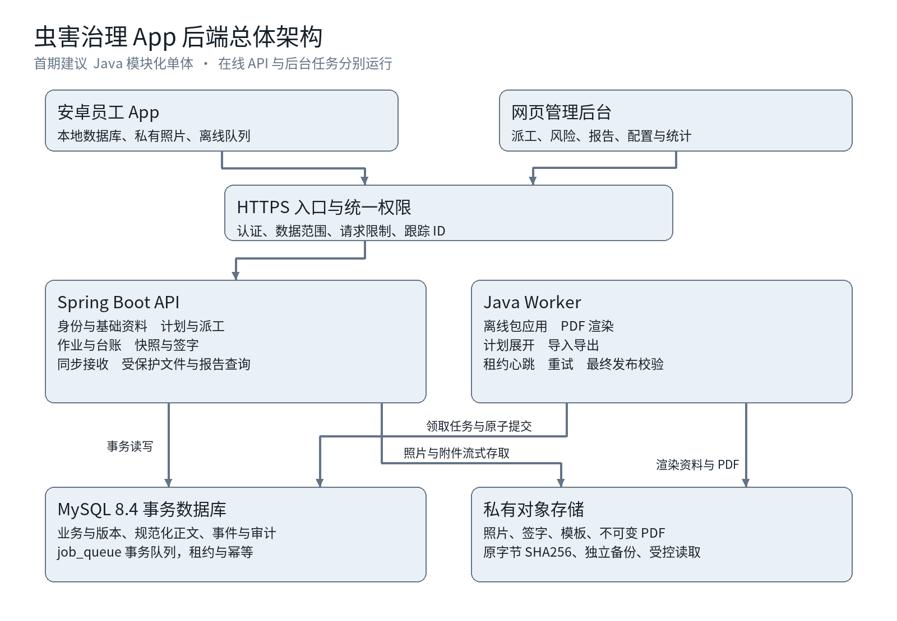
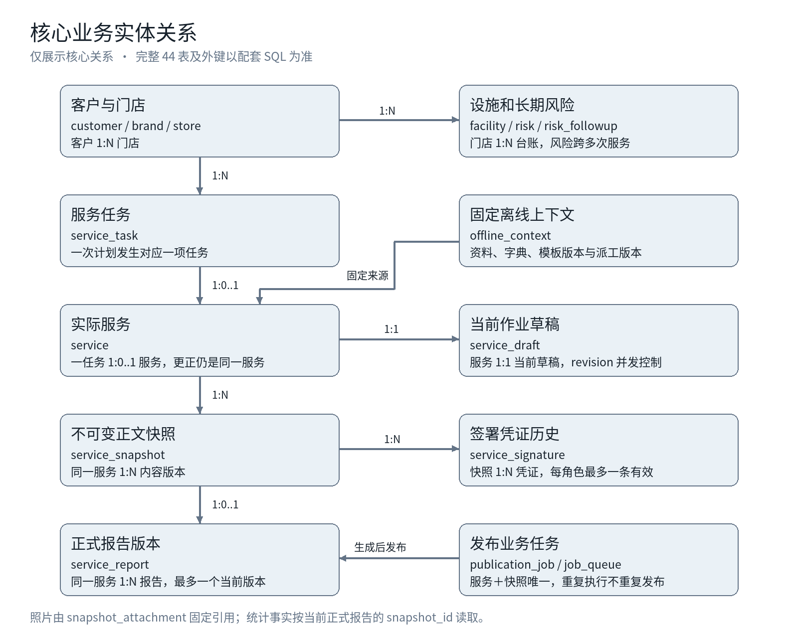
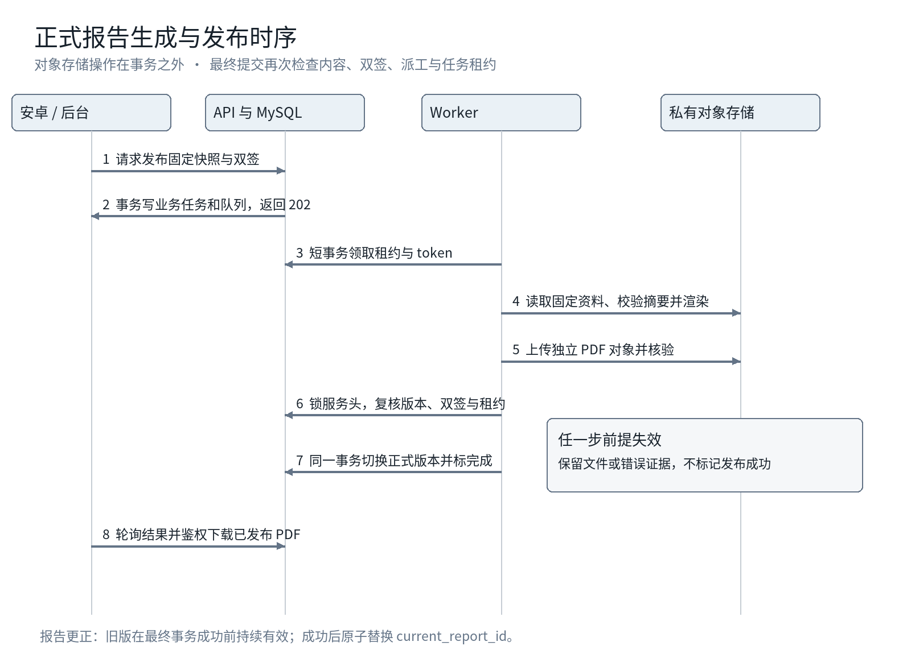

# 虫害治理 App 后端架构设计

V1.0 Java 与 MySQL 实施方案　2026 年 11 月 11 日

面向后端、安卓、后台前端、测试和运维人员。首期采用 **Java 模块化单体、MySQL 事务数据库、私有对象存储，以及独立后台任务进程**。在线请求和耗时报告生成分别运行，共用业务模型与数据库，通过持久化任务表衔接。

Java、MySQL 为用户指定技术。框架版本、进程拓扑、表结构和容量指标为本次设计建议。本文及配套 SQL 用于开发落地和评审，当前白模仍是演示，接口仍是设计契约。

## 1 设计范围与依据

依据现有 20 页安卓白模、V1.0 开发需求、54 项员工端接口和 81 个命名模型设计。API 路径、业务 UUID、快照摘要和双签规则继续沿用；本次不修改既有 OpenAPI 文件。

本系统服务一家虫控公司。员工通过安卓 App 作业，管理人员通过网页后台派工与管理，客户在员工手机上预览、签字。客户没有独立账号。公司内部的区域、团队和授权门店是数据范围边界，首期数据库不增加多租户 SaaS 逻辑。

交付包含架构主文档、44 张表的 MySQL DDL、完整数据字典、54 项接口映射、核心 ER 图、发布时序图，以及关键 SQL 和验证说明。完整后台管理接口尚未定义；本文为其准备模块与数据结构，不将这些后台接口计入已有 54 项。

### 1.1 必须保持的业务规则

| 业务约束 | 架构落实方式 |
|---|---|
| 服务完成不等于风险关闭 | task、service 与 risk 分属不同聚合和状态机 |
| 客户反馈、现场发现、设施捕获分开 | 每条统计事实保留 source，按来源和虫种分组 |
| 零、未检查、数量不明不同 | Quantity 与 Inspection 状态独立建模，不自动补零 |
| 离线作业不得丢失 | 安卓本地事务与文件持久化，后端先持久接收原包 |
| 签字对应固定内容 | 不可变上下文、正文快照和独立签署凭证 |
| 双签不代表已经发布 | 附件校验、有效签字、PDF 成功与最终事务全部通过 |
| 报告更正不覆盖旧版 | 同一 service 的新快照、新双签、新 report 版本 |
| 改派取消后上传不覆盖 | 隔离原提交包，进入异常处理，不直接执行或发布 |

## 2 总体架构与技术栈



API 进程处理鉴权、草稿、台账和查询；Worker 进程处理离线应用、PDF、批量导入导出和计划展开。二者使用同一代码仓库、同一版本的领域模块，独立启动和扩容。首期不要求消息中间件、Redis 或 Kubernetes。

### 2.1 技术基线

| 层级 | 建议选型 | 使用边界 |
|---|---|---|
| Java | Eclipse Temurin 21 LTS | 开发、CI、生产统一发行版和补丁号 |
| Web 框架 | Spring Boot 4.1.2 作为评审基线 | Spring MVC、Validation、Security、Actuator 随 BOM 对齐 |
| 持久化 | Spring JDBC JdbcClient、显式 SQL | 关键更新可检查影响行数，清晰控制锁和事务 |
| 数据库 | MySQL 8.4 LTS、InnoDB | utf8mb4、UTC、严格模式、显式外键和检查约束 |
| 连接池与迁移 | HikariCP、Flyway | 参数压测后定；Flyway 包括对应 MySQL 模块 |
| 文件 | 私有 S3 兼容对象存储 | 存照片、签字、模板、PDF；桶和资源不公开 |
| PDF | Java Worker 调用隔离的 Chromium 渲染进程 | 固定 HTML 模板、字体、渲染镜像；限制并发和外网 |
| 异步执行 | MySQL job_queue | 事务提交任务、租约领取、重试、失败转人工处理 |
| 构建与测试 | Maven Wrapper、JUnit、MySQL 集成测试 | 合约校验、真实数据库并发测试、PDF 视觉回归 |
| 可观测性 | 结构化日志、Micrometer 指标、链路 ID | 不记录完整手机号、签名、令牌和原始服务正文 |

版本核验日期为 2026 年 11 月 11 日。Spring Boot 官方系统要求列出 4.1.2 支持 Java 17 至 27；Temurin 官方提供 21 LTS。实际开工时锁定经安全扫描及兼容测试通过的补丁版本，不使用动态 latest。参考：Spring Boot 系统要求 https://docs.spring.io/spring-boot/system-requirements.html ，Temurin 发布页 https://adoptium.net/temurin/releases/ 。

### 2.2 为什么采用模块化单体

签到、台账提交、冻结和离线应用需要多个业务对象保持一致。首期使用单个 MySQL 事务，能直接实现必要的原子提交。模块边界保留在 Java 包和应用服务层，不提前引入分布式事务。

PDF 比普通 API 更消耗内存和 CPU，因此先拆为独立进程。后续若报告队列长期积压，可以先扩 Worker；只有出现独立团队、独立发布和明显负载边界，再评估拆出独立服务。业务唯一键、事件 ID 和不可变快照不依赖具体队列产品。

## 3 Java 模块与工程组织

| 模块 | 主要职责 | 主要拥有的数据 |
|---|---|---|
| identity | 登录、设备会话、角色、动作权限、数据范围 | app_user、app_role、user_scope、auth_session |
| masterdata | 客户品牌门店、分区、版本化字典须知模板 | customer、brand、store、config_release |
| dispatch | 周期计划、派工、改期改派取消、任务状态 | service_plan、service_task、task_change |
| workorder | 完整作业草稿、签到、校验、内容代次 | service、service_draft |
| ledger | 设施、长期风险、跟进、静态评估、现场提交 | facility、risk、ledger_event、field_commit |
| confirmation | 固定快照、阅读回执、双签、缺席拒签 | service_snapshot、service_signature |
| offline | 下载上下文、离线接收、原包保留和冲突处理 | offline_context、offline_submission、sync_exception |
| media | 受保护文件上传、摘要校验、读取、离线资料 | attachment、upload_session、offline_asset |
| reporting | PDF 生成、发布、报告版本和更正 | publication_job、service_report |
| analytics | 固定快照事实、当前正式版本统计 | snapshot_finding、snapshot_inspection、snapshot_treatment |
| platform | 幂等、审计、任务执行、导入导出 | idempotency_record、audit_log、job_queue |

### 3.1 包结构与依赖方向

```text
pest-backend/
  pom.xml
  pest-domain/        领域对象、枚举、规则及存储端口
  pest-application/   用例服务、事务编排、权限策略
  pest-infrastructure/ JDBC、对象存储、PDF、队列适配
  pest-api/           REST DTO、Controller、安全过滤器
  pest-worker/        任务领取、心跳、执行和重试入口
  pest-contract/      既有 OpenAPI、联调例子、JCS向量
  pest-db/            Flyway迁移和关键SQL
```

各层内部再按 identity、dispatch 等业务模块分包。API 和 Worker 都依赖 application；application 依赖 domain 的接口；infrastructure 实现这些接口。Controller 不直接访问数据库，领域对象不依赖 HTTP。跨模块操作通过公开应用服务或端口完成，不跨包修改其他模块的 Repository。

聚合事务由应用服务声明。FieldCommitApplicationService、OfflineApplyApplicationService 和 PublicationApplicationService 负责多个模块的必要原子编排；不要在内层方法默认开启 REQUIRES_NEW，否则会留下部分成功的数据。编译依赖和模块边界测试阻止反向引用。

计划展开以 planId＋稳定 occurrenceKey 去重，槽位采用门店本地日期和序号，不把可变化的计划版本纳入唯一键。修改计划时对已生成的未来任务逐项保留或显式改期，并记录原因；不能按新计划版本再生成一套相同日期的任务。

### 3.2 关键应用服务

| 服务 | 输入与主要输出 | 事务责任 |
|---|---|---|
| SaveDraftService | 完整 ServiceContent、If-Match → 新 revision | 检查所有权和阶段，只修改草稿 |
| FieldCommitService | 草稿版本 → 逐事件回执 | 原子应用设施、风险、跟进和评估 |
| FreezeService | 当前草稿 → SnapshotPayload 与摘要 | 校验、固定上下文、创建快照及统计事实 |
| SignService | SignatureInput → 签署凭证 | 校验同一快照、先员工后客户、替换失效 |
| OfflineAcceptService | 离线包 → 202 与 submissionId | 原包和执行任务先持久化 |
| OfflineApplyService | 已接收包 → 应用回执或异常 | 全量校验后原子应用，冲突保留双方 |
| PublishService | 固定快照和双签 → publicationJob | 发起异步工作，发布完成时二次原子校验 |
| CorrectionService | 旧报告与原因 → 新草稿 | 保留旧正式报告，开启新内容代次 |

## 4 数据模型与存储策略



数据库采用“关系字段＋完整 JSON＋不可变规范字节”的组合。任务状态、权限、版本、唯一约束、检索和常用统计维度使用关系字段；现场复杂表单使用版本化 ServiceContent；签字正文和上下文另存 JCS 字节。此设计减少草稿多表拼装，同时保留关键统计效率和数据库约束。

### 4.1 三种数据各自的权威来源

| 数据层 | 权威来源 | 可变性与用途 |
|---|---|---|
| 长期台账 | facility、risk、跟进事件、评估历史 | 按预期版本变更，服务未签也可记录真实整改 |
| 作业草稿 | service_draft.content_json | 未冻结时可完整替换，revision 控制并发 |
| 已冻结正文 | service_snapshot.canonical_payload | 内容不可变，是签字、预览和报告正文依据 |
| 上下文 | offline_context.canonical_body | 门店、设施、旧风险、字典和品牌模板的当时快照 |
| 签署凭证 | service_signature.canonical_attestation | 绑定正文，客户姓名评价等作为签署附录 |
| 查询事实 | snapshot_* 表 | 从冻结正文确定性生成，禁止独立修改 |
| 正式 PDF | service_report.object_key 与 pdf_sha256 | 永不覆盖，下载返回原文件，不用最新台账重算 |

报告引用快照、固定上下文和指定签署凭证，不读取门店当前名称或最新药剂字典来填补历史内容。PDF 排版或字体升级不能重新生成并替换已经发布的文件。

### 4.2 关键物理约定

业务主键统一 BINARY(16)，对应接口 UUIDv4。Java 按 RFC 字节顺序绑定；SQL 排查可用 UUID_TO_BIN(uuid,0)，禁止混用 swap_flag=1。首期规模可接受 UUIDv4 的随机索引写入成本；后续增长先测量，不改变客户端离线 ID 协议。

时间保存 DATETIME(6) UTC，Java 使用 Instant；计划日期使用 DATE 和门店 IANA 时区。设备时间、服务器接收时间、现场结束时间和 PDF 发布时间分别保留。服务更正不会重新计算现场服务时长。

状态用 VARCHAR 与 CHECK，避免数据库 ENUM 频繁改表。药剂剂量和浓度在正文中沿用十进制字符串及明确单位，不使用 double、不推断配比。捕获明确数量为 0 至 1000000000；UNKNOWN 不存数量。未检查设施记录在 inspection，不虚造一条捕获数量 0。

组织与字典按单公司设计。config_release 每次发布新增版本，内部字典项目 UUID 稳定且有启停状态；下载上下文固定一个字典版本。停用后新记录不可选，已有历史和有效离线上下文是否可提交由配置版本策略校验，不静默改成其他项目。

### 4.3 JSON 与摘要不能混用

contextDigest 对完整 contextBody 做 JCS；contentHash 对 SnapshotPayload 做 JCS；attestationHash 对不含 attestationHash 字段的 SignatureInput 做 JCS。大小写、数组顺序、字段缺省和 null 的含义必须按已有接口处理，不在签字后补默认值或重排数组。

MySQL JSON 使用内部存储格式，不能把数据库再次序列化出的 JSON 当作原始签字字节。服务端同时保存 canonical_payload BLOB 和查询副本，摘要从规范化 UTF-8 字节计算。JCS 按 RFC 8785 实现，拒绝重复 JSON 键、NaN 和不符合模型的数据，使用既有联调示例做 Java 与安卓交叉验证。参考：https://www.rfc-editor.org/rfc/rfc8785 及 https://dev.mysql.com/doc/refman/8.4/en/json.html 。

### 4.4 数据库能保证和不能单独保证的规则

数据库使用 96 条外键及业务唯一键限制重复记录、有效签字和当前正式报告。表间只做 RESTRICT，不级联删除历史。snapshot 与 service、report 与 service、facility 与 store 的关键关联使用复合外键约束。

数据库不能单独验证某员工现在是否授权、引用的照片是否同门店、字典 UUID 是否属于指定版本、客户签字是否对应同一员工签字快照，以及风险迁移是否合法。这些由同一事务内的领域校验负责。DDL 不等于已经实现这些规则。

正式正文、事件和报告记录以插入为主；应用数据库角色不开放普通业务删除。报告状态、快照作废标记和签字失效时间允许受控更新，内容字段不允许更新。数据库迁移账号、运行账号和只读排查账号分别授权。

## 5 在线服务流程与事务边界

### 5.1 草稿保存与台账提交

下载上下文后创建 service；service_task 与 service 的唯一关系防止同一任务重复创建实际服务。签到及各模块通过完整 PUT 保存。服务端先检查 If-Match 和操作权限，再更新 revision；缺少版本返回 428，版本变化返回 412。客户端收到冲突后保留本地草稿，由用户选择合并，不能把全量 PUT 当成字段 PATCH。

保存草稿不会自动改变设施或长期风险。用户提交现场记录时，field-commits 按固定次序锁住 task、service、draft，再按 UUID 排序锁定涉及的台账行。依次校验事件 ID、摘要和 expectedRevision，应用变更、追加事件、写 field_commit 回执，并令 field_commit_revision 等于当前 draft revision，一次提交。

同一事件 ID、同一内容重试，返回原回执；同一 ID 改内容返回 409。即使旧 expectedRevision 已过时，已应用的相同事件应先命中幂等回执。新事件版本不符时整批回滚，不形成半组设施和风险。

任何草稿变化都会让 draft revision 增加。即使只改总结，冻结前仍需再次提交 field-commits；未改变的旧事件复用回执，以新的 field_commit_revision 表示这份完整草稿已经对齐台账。风险在草稿放弃或拒签后仍保留已实际提交的进展。

### 5.2 冻结与完整性检查

冻结前执行已有 V01 至 V16 规则：签到和定位异常说明、服务须知版本确认、模块填写状态、设施本次照片或未检查原因、虫情处置或原因、历史未关闭风险跟进、用药字段、总结和风险评级依据、低于建议时长说明、附件引用和数据归属等。

冻结事务重新检查权限、派工版本和 field_commit_revision，确定 content_version、head_revision 和固定模板。规范字节在内存校验后写入 snapshot、snapshot_attachment 及 snapshot_* 查询事实，更新 service.active_snapshot_id。输入中的字典、门店和记录 UUID 必须属于本上下文允许范围。

HTTP 校验通过只是当时结果，冻结、签字和发布仍各自检查关键条件。冻结接口不能相信此前一次 validations 的布尔结果。离线冻结由安卓完成同一规范算法，上线由后端重新验算，不把客户端摘要当作可信事实。

### 5.3 双签与内容更正

员工先签，客户预览至少 5 秒并主动确认后再签。客户签名绑定 snapshotId、contentHash、staffSignatureId 和 previewSessionId。离线可见时长作为客户端证据保存；它不能证明客户实际阅读，也不是服务器可信计时。

签字事务锁同一 service 行并检查 active_snapshot_id、head_revision。一个快照每种角色最多一条有效签字，由 generated active_role 的唯一索引兜底。替换员工签字时，先作废旧员工签字及其关联客户签字，再插入新凭证；所有历史保留。

尚未发布的正文修订：head_revision 递增、旧快照作废、相关签字失效、旧发布任务阻断，再恢复可编辑草稿。签字图片不能复制到新正文继续生效。

已发布报告更正：同一 service 新建草稿内容代次，correction_of_report_id 指向旧版；task.status 仍为 COMPLETED，current_report_id 仍指旧报告。新版本重新冻结和双签。报告 v1 的现场开始结束时间保持不变，更正签署时间另记在 v2 签署凭证中。

## 6 离线同步与冲突处理

### 6.1 下载与本地责任

offline_context 固定任务、门店、设施、全部未关闭风险、上次评估、字典、须知、品牌、模板和资产清单。客户端下载所有必需文件并核对摘要后，提交 download-receipt 才标记可离线作业。应急任务只能使用已经下载且仍在策略允许范围内的授权门店上下文。

安卓采用账号隔离的本地数据库和应用私有文件目录。文字、拍照、签字先落盘，再显示保存成功；本地事务保存业务记录和同步队列，照片完成写入与校验后再建立引用。App 重启恢复队列。后端收到 202 只表示原包已接收，客户端不能据此清理原照片；应在 APPLIED、附件已验证且正式报告发布或异常已明确处置后，按保留策略清理。

### 6.2 接收与应用分为两个事务

接收阶段先鉴权、限制包大小、校验 JSON 结构和身份上下文；以 submissionId 和 request_hash 防重复。事务 A 保存完整 canonical_payload、接收时间和一条 SYNC_APPLY job，提交后才返回 202。已有同 ID 不同内容返回 409。

执行阶段读取持久原包，验算上下文、正文与签署摘要，核查已上传附件。事务 B 按统一锁顺序重新检查任务派工、草稿 baseRevision、门店权限和每个台账版本；一次应用草稿、台账、快照、双签和可选发布任务，写应用回执。如果任何业务冲突则整笔回滚。

冲突记录写入独立的后续事务，更新 submission 状态并保存 sync_exception；原始提交包不在回滚事务中，所以不会丢失。验证错误标为 REJECTED，调度或版本冲突标为 CONFLICT。临时数据库、对象存储故障保持可重试，不能误报成业务拒绝。

### 6.3 改派取消与异常授权

正常写入必须满足当前权限和 assignmentVersion。旧员工的离线授权不能继续访问改派后的任务数据。仍可登录且持有原下载凭据的员工，可在 evidence_until 内把自己的原包与附件送入 QUARANTINE；该通道只接收原上下文门店和本人记录，不返回现执行人草稿、照片或报告。

已禁用账号不能通过此通道自动恢复访问，设备保留本地资料，由管理员按公司流程临时恢复仅证据提交能力。隔离读取仅限范围内主管；允许将上传人自己的状态反馈给本人，不泄露现有服务内容。

主管可保留隔离证据、拒绝不适用内容，或选择有效记录生成一份明确的新草稿。不能只改 assignmentVersion 后自动发布原双签。凡处理导致正文或服务归属变化，都需要新的快照和重新确认。

### 6.4 三层幂等

| 层次 | 约束 | 保证范围 |
|---|---|---|
| HTTP 请求 | actor＋operationId＋Idempotency-Key 摘要 | 超时重试返回同一业务结果，同键不同请求 409 |
| 业务对象 | 客户端 UUID、事件摘要、task→service 唯一关系 | 幂等缓存清理后，仍不会新建重复任务或事件 |
| 后台执行 | kind＋businessId、租约和 fencing_token | 允许重复运行，但发布和应用只生效一次 |

HTTP 幂等记录与同步业务变更在同一事务提交。长耗时工作只创建持久任务并返回 202，不能保持数据库事务等待 PDF。幂等响应也要在返回前检查当前访问权限，不能通过旧缓存绕过撤权。

## 7 报告生成与发布一致性



### 7.1 队列与 Worker

publication 请求锁 task、service，校验当前快照、两条有效签字、所有附件 VERIFIED 映射状态和作业阶段，创建 publication_job 与 job_queue 后返回 202。相同 serviceId＋snapshotId 返回已有任务；失败重试沿用业务任务，不创建第二份报告。

Worker 在短事务中使用 FOR UPDATE SKIP LOCKED 领取到期任务，递增 fencing_token、设置租约与状态后立即提交。在事务之外渲染。心跳只在 owner 与 token 都匹配时延长租约；租约到期可重新领取。SKIP LOCKED 仅用于工作队列，业务数据读取不能跳过锁定行。依据：https://dev.mysql.com/doc/refman/8.4/en/innodb-locking-reads.html 。

渲染失败指数退避并增加随机抖动；达到上限转 DEAD，publication_job 记 FAILED。BLOCKED 表示正文或授权等前提变化，需要处理原因，不能无限自动重试。MySQL binlog 使用 ROW。

### 7.2 外部文件与数据库之间的一致性

PDF 从规范正文、原上下文、固定签署凭证和指定模板生成。下载私有文件时核对期望 SHA256，禁止渲染任意公网 URL。HTML 所有用户输入转义，禁用脚本和外部网络，限制页数、图片像素和渲染时长。

每次渲染写入带 jobId、fencingToken 和 PDF 摘要的独立对象键。先上传并确认对象可读取、大小和摘要一致，再开始最终数据库事务。旧 Worker 不可覆盖新 Worker 的对象键；已发布对象永不原地覆盖。

最终事务按固定顺序锁 task、service 和 job 行，重新检查租约 token、head_revision、active_snapshot_id、任务未取消未改派、附件摘要和有效双签。全部通过后插入 service_report、切换 current_report_id、更新任务 COMPLETED、写审计和完成通知，并把 job 标记成功。首次发布记录 completed_at；实际现场结束时间不取此时间。

更正版发布先在同一事务将旧报告标为 SUPERSEDED，再插入新 PUBLISHED 报告和切换指针，事务外读者看到完整的旧版或新版。唯一索引限制每个 service 最多一个 PUBLISHED 报告。

若 PDF 上传成功但最终事务失败，文件成为未引用对象，后台按宽限期核对数据库引用后清理。若数据库成功但响应丢失，重试查询已有报告。若正式文件随后存储故障，保留发布事实并报警、从备份恢复原字节，不能重新生成不同文件覆盖。

### 7.3 报告统计口径

统计日期约定：计划和取消按 plannedDate，完成服务与虫情趋势按原始 serviceStartedAt 对应门店业务日；逾期与待整改是查询时点存量，界面须注明这一口径。正式服务量以当前有效正式版本为统计入口，service.current_report_id 指向 service_report，再关联其 snapshot_id。更正前后的多份快照不能重复统计。计划、取消和逾期数直接来自任务表；风险待整改和逾期数来自当前风险台账。

虫情按 CUSTOMER、ON_SITE、FACILITY 及 pest_type_id 分组。已知数量求和，UNKNOWN 单独计数；设施 NOT_CHECKED 与 UNCONFIRMABLE 分列。示例 15、10、38 仍分属各自来源或虫种，不产生 63 的默认总量。设施覆盖率分母取本次上下文应检查设施，加本次新建需检查设施并按明确业务规则扣除已移除不适用设施，分子取 CHECKED；报告中应保存该口径和结果。

## 8 数据库索引与并发设计

### 8.1 主要查询路径

| 查询 | 索引或访问路径 | 注意事项 |
|---|---|---|
| 我的今日与日历任务 | assignee_id、planned_date、status、id | 权限先过滤，日期区间有上限 |
| 门店设施 | store_id、status、id | 已移除记录仅按历史需要展示 |
| 未关闭或逾期风险 | store_id、status、due_date、id | due_date 用门店本地日期判定 |
| 草稿恢复 | service_id 唯一索引 | 只允许当前授权人员访问 |
| 报告版本 | service_id、version_no 唯一索引 | 列表显示当前版本，历史受控可查 |
| Worker 领取 | status、next_run_at、id | 小批量加锁，禁止全表扫描 |
| 同步异常处理 | status、created_at、id | 返回最小必要证据与冲突说明 |
| 虫情趋势 | 正式报告→snapshot→来源虫种 | 按范围和业务日期过滤，避免扫描所有草稿 |

分页沿用接口游标，排序必须稳定并包含 id，不使用大偏移量扫描。EXPLAIN ANALYZE 在测试数据上验证关键查询，避免为所有 JSON 字段随意加索引。首期不分库分表，归档策略不得破坏报告可追溯性。

### 8.2 统一锁顺序与隔离级别

建议业务事务 READ COMMITTED，所有依赖写一致性的读取显式 SELECT FOR UPDATE 或带 revision 的条件更新。并发控制不能仅靠“先查版本再更新”两个无锁语句。成功更新必须检查 affectedRows=1。

统一锁顺序为 task → service → draft → 按 UUID 排序的台账 → snapshot/signatures → publication_job → job_queue。队列领取事务只锁 job_queue，领取后即提交；最终发布事务再按上述顺序获取业务锁，不在领取时长时间占锁。

死锁可用相同请求和业务 ID 做有限次数退避重试，但业务版本冲突必须返回冲突。并发重开、替换签字和发布均串行化在同一 service 行和 head_revision 上，不能只锁 signature 表。

### 8.3 数据库参数与迁移

采用严格 SQL 模式，连接设置 UTC 和 utf8mb4，启用持久事务日志；连接池按数据库总连接预算分配。不要让每个新 API 或 Worker 实例都无限增加连接。大文件通过流式处理，数据库只保存元数据和有限大小的正文 JSON。

V001 SQL 面向空 schema；生产结构变更以新增 Flyway 版本执行，不改已经执行的 V001。先扩展字段、兼容写读，再迁移旧数据和收紧约束。DDL 需要独立发布步骤和备份，不能依赖业务事务回滚恢复失败改表。

## 9 权限与文件安全

JWT 短期访问令牌＋可轮换刷新令牌；刷新令牌只存摘要，绑定设备会话。注销、停用、改权限后服务端检查 session 和 permission_version。建议权限和会话校验先读 MySQL，后续加缓存也必须有失效策略，不能等待长缓存自然过期。

数据权限由 ScopePolicy 生成授权查询条件，列表、详情、写入、附件、统计、导入导出、历史报告统一执行。serviceId 或 attachmentId 随机并不能替代权限检查。跨门店关联返回拒绝，避免泄露资源是否存在的详细差异。

图片上传采用已有整文件协议：建立会话、上传原字节、校验完成。检查真实 MIME、大小、像素、摘要及恶意内容。校验失败不能转 READY；客户端照片不因转码而改变原始哈希，若生成缩略图使用新派生对象。媒体原始文件不存 MySQL BLOB。

对象桶只允许后端访问。对用户返回受鉴权的内容接口，或服务器内部短时读取凭据；不向客户生成公开永久链接。安卓正式分享下载到受控缓存后通过 FileProvider 调用系统分享。客户预览入口只返回当前快照与当前确认流程，不返回完整员工会话数据或其他门店列表。

日志脱敏，手机号和必要联系人字段加密存储；签字、定位和照片按对象存储加密及业务授权保护。正文快照包含必要个人信息，数据库与备份也需访问控制和静态加密；仅加密手机号列不能覆盖全部敏感信息。

## 10 部署与运行保障

### 10.1 建议的试点拓扑

试点使用 Linux 容器环境：入口反向代理、1 个 API 实例、1 个 Worker 实例、独立 MySQL 实例、私有对象存储和备份目标。该规模有应用单点，适合小范围验证；正式使用如要求持续可用，再部署至少 2 个 API 实例、可替换 Worker 和具备故障切换的数据库。客户端离线作业不能替代后端备份。

初始资源建议 API 2 vCPU／4 GB、Worker 4 vCPU／8 GB、MySQL 4 vCPU／8 GB，均为压测起点。PDF 同时渲染先设 2 个，数据库连接按实例总量配置。照片流量直连 API 流式转储可能成为瓶颈，先验证带宽再考虑保持 API 契约的网关卸载。

### 10.2 容量估算方法

用“100 名员工、每天 500 次服务、每次 30 张照片、每张平均 0.8 MB、全年 365 天”作为容量演示，不作为实际业务承诺。照片约 12 GB／日、4.38 TB／年；每份 PDF 5 MB 约 0.91 TB／年。原图、缩略图、版本和备份会进一步增加容量，应按真实拍摄压缩策略重新估算。

若每份规范正文及上下文合计 200 KB，每年 182500 次服务约 36.5 GB 原始正文；JSON 查询副本、索引、事件、修订和备份不在这个数字内。首次数据库磁盘可从 200 GB 起评估，设置容量告警和自动扩展，不能把照片容量算入数据库磁盘预算。

### 10.3 监控与恢复

| 指标 | 建议初始告警条件 | 处理方向 |
|---|---|---|
| API 错误与延迟 | 连续 5 分钟错误率异常或 p95 超目标 | 区分权限冲突、业务拒绝与系统故障 |
| 同步队列 | 最老可处理任务等待超过 5 分钟 | 数据库锁、Worker 心跳和异常重试 |
| 报告队列 | 最老任务超过 5 分钟或连续 3 次失败 | 模板、字体、图片、渲染进程内存 |
| 对象存储 | 上传校验失败率或已发布文件读取失败 | 网络、配额、对象缺失、恢复原文件 |
| MySQL | 磁盘剩余不足 20%、慢查询、死锁激增 | 扩容、索引、连接预算、事务时长 |
| 业务异常 | 逾期任务风险、长期未处理同步冲突 | 分配业务人员跟进，不自动关闭 |

建议目标 RPO ≤ 15 分钟、RTO ≤ 4 小时，需部署预算与恢复演练验证。每日数据库全量备份并持续保存 binlog；对象存储开启版本保护和独立备份。数据库、PDF、照片、模板和密钥都需要恢复方案，保留周期由公司统一配置。

每月在隔离环境演练恢复：还原数据库到指定时间点，检查报告对象和 SHA256、双签引用及对象访问权限，再抽查一份完整报告。备份成功日志不等于恢复成功。运行配置、密钥和对象存储策略随部署交付，不把凭据写入源码或设计文件。

## 11 与白模及接口的对应关系

| 白模页面组 | 主要后端模块 | 当前覆盖 |
|---|---|---|
| 登录与我的 | identity | 会话、用户资料、配置 |
| 工作台与任务日历详情 | dispatch、analytics | 我的任务、汇总、变更、应急任务 |
| 签到与服务前确认 | workorder、masterdata | 草稿保存、须知、客户反馈 |
| 静态评估与设施点检 | workorder、ledger | 草稿、设施变更、检查和捕获 |
| 风险列表详情新增 | ledger | 长期风险、服务内外跟进 |
| 防治与总结 | workorder | 处置、用药、总结、校验 |
| 预览与双方签字 | confirmation | 固定快照、阅读回执、双签 |
| 同步中心 | offline、media | 原包、附件、隔离异常和处理 |
| 正式报告 | reporting | 生成状态、PDF、历史版本和更正 |

所有 54 个 operationId 均在《接口到模块和数据表映射.md》中逐条列出。Controller DTO 使用既有 camelCase，数据库采用 snake_case，经显式 Mapper 转换。

### 11.1 落地时需要收紧或补充的契约

现有 OpenAPI 的部分文本字段统一使用 maxLength=2000，而业务编号、名称和联系人字段需要更具体的长度。本 DDL 提供具体物理上限，开发前必须同步收紧对应接口模型或扩展列宽；所有超长值返回结构化 422，禁止截断。此项是接口评审修订项，不能直接宣称既有接口与 DDL 零差异。

附件内部 PENDING／VERIFYING 映射 API WAITING，READY 映射 VERIFIED，FAILED 映射 REJECTED。作业 phase 与接口保持一致；更正通过 correctionOfReportId 表达，不新增一个与接口冲突的任务状态。设施 INACTIVE 与接口一致，耗材 NOT_APPLICABLE 独立保存。

Capture 没有独立 id，设施捕获事实按 Inspection.id＋pestTypeId 去重；同次检查同一虫种出现两次需返回 422。risk 的多个 pestTypeIds 存 JSON 数组，不退化为单个虫种；设施点检 UNCONFIRMABLE 独立于 NOT_CHECKED，捕获 Quantity 保留 EXACT／UNKNOWN。统计表是冻结正文的派生事实，任何未知或缺省值都不能被关系字段默认值吞掉。

本次另补充内部 head_revision、租约 fencing_token、不可变规范字节、隔离资料期限等实现字段，不要求暴露给 App。离线授权期限、上传限制、编号规则、重复应急任务判定窗口和定位阈值继续由业务配置评审确定。

后台账号配置、客户门店导入、周期计划、药剂字典维护、复杂台账更正、导出和运行监控需补管理端 OpenAPI。复杂台账更正必须追加补偿或纠正事件并保留原历史，不能重写已签快照。普通服务闭环不等待后台页面全部完成。

## 12 开发顺序与验收

### 12.1 建议实施阶段

第一阶段建立 Java 工程、迁移、权限和客户门店，完成派工及真实 MySQL 集成测试。先跑通一个员工、一个门店、一次任务的数据范围与并发控制。

第二阶段实现完整草稿、附件、台账事件和下载上下文，安卓验证断网、强杀、重启恢复。至少覆盖有虫情处置、无虫但有风险、未检查设施和跨服务风险四类业务。

第三阶段实现规范化快照、双签、异步 PDF、最终发布和报告更正。将联调示例同时用于 Java 和安卓；引入模板及字体回归样本。

第四阶段完成冲突处理、统计、管理端补充接口、备份恢复与试点压测。先在少量门店使用，监测失败队列和照片体积，再调整并发和存储预算。这里不承诺未估算的工期或报价。

### 12.2 必测的关键场景

| 场景 | 通过条件 |
|---|---|
| 草稿并发 | 两端同 revision 更新只有一个成功，另一份本地数据保留 |
| 台账批次失败 | 一条事件版本冲突导致整批回滚，旧回执可重用 |
| 离线原包保留 | 事务 B 回滚后 submission 原字节仍存在 |
| 离线改派 | 原员工只能提交隔离证据，无法读取新员工资料 |
| 重复上传提交 | 同 ID 相同内容重用结果，不同内容返回冲突 |
| 签字并发与替换 | 每角色一条有效签字，员工替换使对应客户签字失效 |
| 重开与发布竞态 | 旧 head_revision 或旧租约 Worker 无法发布 |
| 报告更正 | 新版成功前旧版有效，成功后仅一个当前版本 |
| 文件故障 | 缺图、坏摘要、渲染失败、上传失败均不标已完成 |
| 历史稳定 | 修改字典门店设施后旧正文、签名和 PDF 字节不变 |
| 分来源统计 | 客户 15、设施飞虫 10、设施其他 38 分列，未知独立 |
| 权限隔离 | 越权详情、附件、报告、导出和统计全部被拒绝 |
| 恢复演练 | 指定时点库和对象恢复后，报告引用与哈希可核对 |
| PDF 排版 | 中文、长文本、跨页表格、照片、签字无缺字或错配 |

### 12.3 本次交付的验证边界

已对 DDL 在本机隔离的 MySQL 9.6 测试实例执行建表与关键约束验证；目标生产基线为 MySQL 8.4，尚需在 8.4 集成环境复验。未连接或修改用户现有数据库。具体已执行项目与结果见《验证与交付说明.md》。

架构设计没有替代真实 Java API、安卓同步、并发压力和 PDF 生成实现测试。上线验收以完整服务闭环、数据不丢失、报告可追溯为准。
